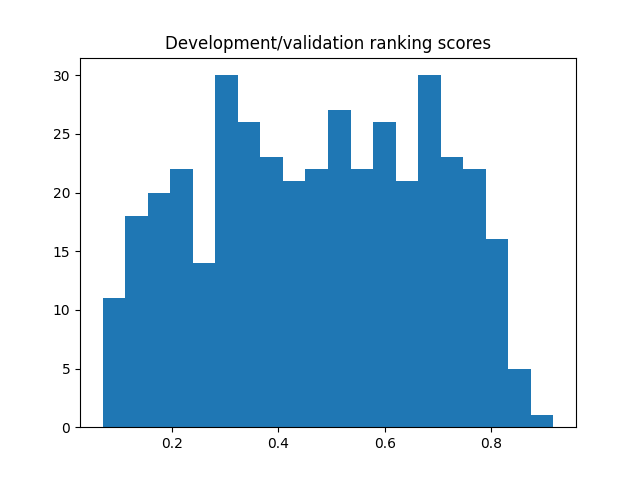

# AI-Assisted Equity Pairs Research

**Carter Sheley · Python · quantitative research · AI-assisted development**

An exploratory research pipeline that uses PCA factor exposures and Ward hierarchical clustering to find candidate equity pairs, then compares statistical qualification with validation-based economic ranking. This is a portfolio demonstration of research design, data engineering, and AI-assisted software development. It does not establish a profitable trading strategy.

## Start here

Open [the research walkthrough](notebooks/research_demo.ipynb) for saved outputs and explanatory code, or read [the methodology](docs/METHODOLOGY.md). The notebook can run against included summary results without downloading prices or rerunning the model.

## What the project does

1. Reconstructs a 904-security S&P 500 / S&P MidCap 400 universe as of December 29, 2023, retaining separate share classes and identity-review flags.
2. Collects adjusted-price histories and maps them to project security IDs.
3. Preserves unavailable observations and calculates eligibility using formation data only.
4. Standardizes daily stock returns, extracts common factors using PCA, and clusters stock exposures using Ward linkage.
5. Tests candidate pairs and compares strict FDR selection with exploratory validation-profitability ranking.
6. Simulates next-session execution with configurable transaction and borrowing costs.

## Reference findings

| Outcome | Recorded result |
|---|---:|
| Frozen universe | 904 securities |
| Eligible equities in development and refit runs | 821 |
| Development (2021–2022) factors / candidates | 13 / 400 |
| End-2023 refit factors / candidates | 16 / 396 |
| Strict selected pairs | 0 |
| Exploratory selected pairs | 10 |
| Exploratory aggregate test return | Unavailable: incomplete valuations |

The strict strategy abstains. The exploratory selection is a research output, not evidence of a trading edge. The unresolved valuation issue is described in [known limitations](docs/KNOWN_LIMITATIONS.md). No missing return is replaced with zero to manufacture performance.



## Run the demo

From the repository root, in Anaconda Prompt:

```bat
conda create -n statarb python=3.12 pip ipykernel -y
conda activate statarb
python -m pip install -r requirements.txt
python -m ipykernel install --user --name statarb --display-name "Python (statarb)"
python run.py test
```

Open `notebooks/research_demo.ipynb` in VS Code or Jupyter, select **Python (statarb)**, and Run All. Package installation happens in the terminal; kernel selection happens separately in the notebook.

## Rerun the model with local price data

Place the previously prepared `adjusted_prices.parquet` in `data/processed/`, then run:

```bat
python run.py model
```

A new output folder is created automatically under `results/local/`. To compare longer development histories:

```bat
python run.py model --development-start 2016-01-01
```

See [data instructions](data/README.md) to acquire and prepare inputs. Fresh public downloads may differ from the recorded snapshot. The public package excludes raw prices, processed price matrices, archived third-party source files, and the large embedded-data notebook.

## Repository map

| Location | Contents |
|---|---|
| `notebooks/` | Lightweight walkthrough with saved displays |
| `src/model/` | V2 discovery, ranking, signals, accounting, diagnostics |
| `scripts/` | Universe construction, price acquisition, coverage, preparation, and V1 |
| `config/` | Default experiment settings |
| `tests/` | Seven accounting and timing tests |
| `results/reference/` | Recorded V2 outputs; preserved, not overwritten |
| `results/v1/` | Corrected earlier discovery results |
| `data/universe/` | Constructed roster and identity-review records |
| `docs/` | Methods, provenance, limitations, and validation notes |

## AI collaboration and scope

ChatGPT assisted with implementation, debugging, research discussions, tests, and documentation. [AI_COLLABORATION.md](AI_COLLABORATION.md) distinguishes those contributions from the project owner's decisions. Tests and a successful run demonstrate specific behavior, not a complete independent audit.

December 2023 membership creates selection bias for earlier histories. The 2024–2025 test is conditional on that roster. Fundamentals, observed borrow/liquidity screening, exposure caps, and walk-forward discovery are not implemented.

Licensing permissions have not been assigned in this package. See [reuse and data notes](docs/REUSE.md). This repository is a sample-work project and is not investment advice.
